# AI Workspace · Claude·Codex 대시보드 사용 매뉴얼

Claude Code와 Codex 세션을 한 화면에서 찾고, 실행하고, 비교하는 로컬 웹 대시보드입니다.

> **기준: 2026.10.21 최신 작업본.** 작업 공간·Design Mode·세션 정리는 서버 **API 10 이상**에서 사용합니다. 이전 서버를 계속 사용 중이면 서버를 재시작해야 합니다. 이 문서는 기능 안내이며 배포·커밋 완료를 뜻하지 않습니다.
>
> 스크린샷은 실제 대시보드 UI에 **설명용 프로젝트·세션·AI 응답·사용량**을 넣어 촬영했습니다. 실제 작업 로그나 계정 사용량이 아닙니다. 모바일·원격 접속 및 실행 파일 앱은 이 매뉴얼의 대상이 아닙니다.

| 하고 싶은 일 | 볼 곳 |
| --- | --- |
| 대시보드 열기·메뉴 익히기 | 1~2 |
| 기존 AI 세션을 이어서 사용하기 | 3~4 |
| Claude·Codex에 같은 작업 맡기기 | 5~8 |
| 코드·문서를 직접 확인하거나 수정하기 | 9~10, 12 |
| 웹 화면의 요소를 골라 수정 요청하기 | 11 |
| 쌓인 실행 중 표시·세션 정리하기 | 13 |
| 알림·실황·연결·설정 확인하기 | 14~16 |

## 1. 실행과 기본 화면

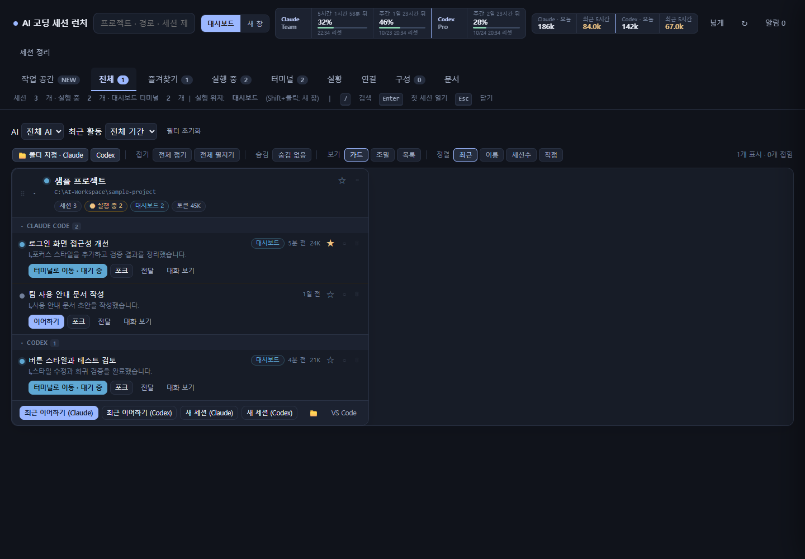

**실행:** `cc-launcher` 폴더의 **Launch.vbs** 또는 연결된 바로가기 → 브라우저에서 `http://127.0.0.1:7788`.

처음에는 Node.js와 Claude Code/Codex CLI 설치·로그인이 필요합니다. 이미 서버가 실행 중이면 브라우저만 열립니다. 소스 저장소: [ClaudeCode_DashBoard](https://github.com/macjoocan/ClaudeCode_DashBoard).

상단 검색창으로 프로젝트·경로·세션 제목을 찾습니다. 오른쪽에는 AI별 **사용 한도·리셋 시각**과 **오늘/최근 5시간 토큰 사용량**이 보입니다. 한도와 토큰 합계는 서로 다른 지표이며, 조회가 안 되는 환경에서는 일부 항목이 표시되지 않을 수 있습니다.

## 2. 전체·즐겨찾기·실행 중에서 세션 찾기

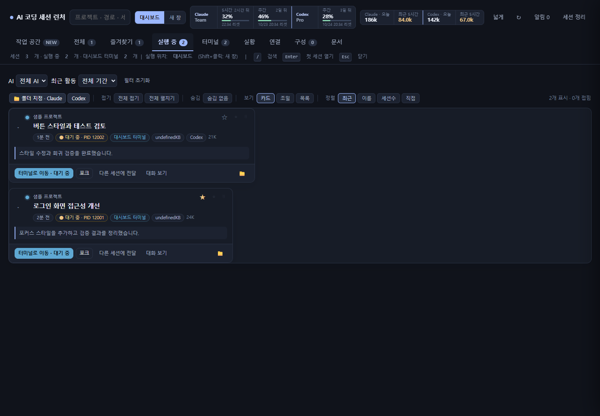

**전체**는 프로젝트별 세션, **즐겨찾기**는 ★한 세션, **실행 중**은 실행 상태가 잡힌 세션을 모아 봅니다.

**AI / 최근 활동** 필터로 범위를 좁히고, 세션의 **☆**를 눌러 즐겨찾기에 등록합니다. **이어하기**는 기존 대화를 계속하고, **포크**는 기존 대화를 바탕으로 별도 세션을 시작합니다. 내장 세션은 **터미널로 이동**, 외부 창 세션은 **창 띄우기**가 표시됩니다.

카드·조밀·목록 보기, 접기/펼치기, 최근/이름/세션 수/직접 정렬로 목록을 줄일 수 있습니다. `실행 중` 수는 남아 있는 상태 표시를 포함할 수 있으므로, 실제 구동 여부가 궁금하면 **세션 정리**에서 확인합니다.

## 3. 터미널 분할과 세션 관리

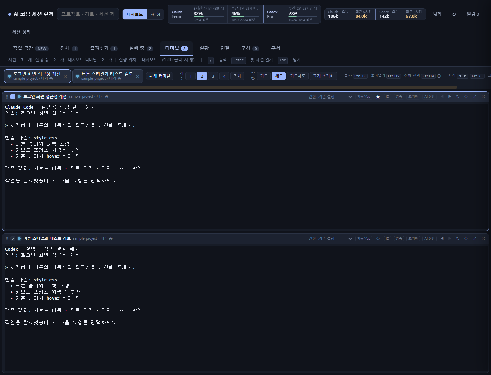

실행 위치를 **대시보드**로 두고 세션을 열면 **터미널** 탭에서 사용합니다. 상단의 **개수 1/2/3/4/전체**, **가로/세로/가로세로**로 배치하고, 경계선을 끌어 크기를 조절합니다. 위 화면은 2개를 세로로 나눈 예입니다.

| 터미널 위 버튼 | 동작 |
| --- | --- |
| ☆ / ★ | 현재 세션 즐겨찾기 |
| ID | 세션 ID 복사. 첫 대화 전에는 비활성일 수 있음 |
| 압축 | 현재 대화를 요약 압축해 컨텍스트 공간 확보 |
| 초기화 | 대화 기록을 보존하면서 빈 컨텍스트의 새 세션 시작 |
| AI 전환 | 현재 작업을 요약하고 Claude ↔ Codex로 인수인계 |
| ↻ | 화면 연결만 새로고침. 세션은 유지 |
| 재시작 / ✕ | AI 프로세스 재시작 또는 세션 종료 |

**압축·초기화·AI 전환은 확인 팝업 후 동작합니다.** AI 전환은 현재 작업 요약을 전달하는 방식이며, 이전 AI의 내부 컨텍스트 전체를 그대로 옮기는 것은 아닙니다. 권한 모드 변경은 세션 재시작을 수반하며 CLI·조직 정책의 적용을 받습니다.

브라우저 새로고침·탭 닫기는 내장 AI를 종료하지 않습니다. **서버 재시작·종료는 내장 AI를 중단**하므로 작업을 마친 뒤 진행하세요.

## 4. 다른 세션에 메시지 전달

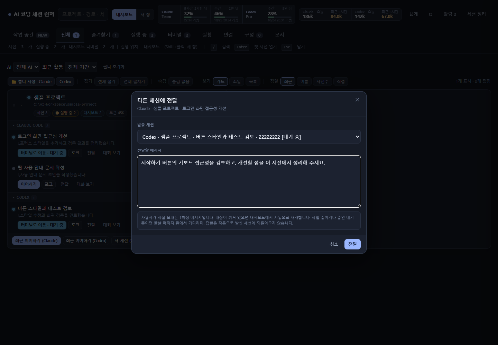

세션의 **전달** → **받을 세션** 선택 → 요청 작성 → **전달**.

Claude → Codex, Codex → Claude뿐 아니라 **Claude → Claude, Codex → Codex**도 지원합니다. 자기 자신에게는 보낼 수 없습니다.

상대가 작업 중이거나 승인 대기 중이면 전달 큐에서 기다립니다. 꺼진 대상은 대시보드에서 재개할 수 있지만, 외부 창에서 실행 중인 대상은 먼저 대시보드 터미널로 열어야 합니다. **답변은 발신 세션으로 자동 회신되지 않습니다.** 대상 세션에서 확인하세요.

## 5. 새 작업 공간 만들기

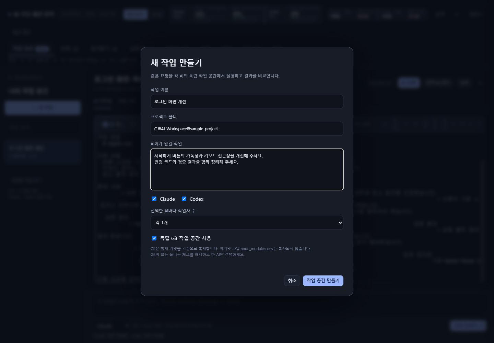

**작업 공간 → ＋ 새 작업**에서 작업 이름·프로젝트 폴더·요청을 입력합니다. Claude/Codex와 작업자 수를 고른 뒤 **작업 공간 만들기**를 누릅니다.

선택한 AI마다 1~2개, **전체 최대 4개**까지 만들 수 있습니다. **독립 Git 작업 공간**을 켜면 같은 시작 커밋에서 AI별 폴더·브랜치를 따로 만듭니다.

**미커밋 파일·Git에서 제외된 .env·node_modules는 복사되지 않습니다.** 각 작업 공간에 필요한 의존성과 실행 환경을 준비하세요. Git이 없는 일반 폴더는 독립 작업 공간을 해제하고 **AI 1개만** 선택합니다.

## 6. 작업 공간에서 병렬 실행·추가 요청

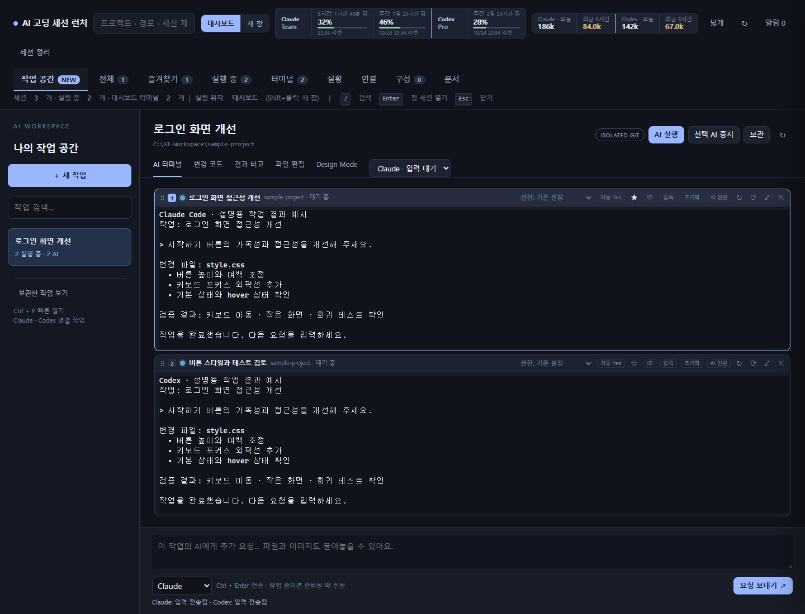

작업을 고른 뒤 **AI 실행**을 누릅니다. 처음 요청은 AI가 준비되면 한 번 전달됩니다. 폴더 신뢰·로그인 등 시작 확인이 뜨면 해당 터미널에서 직접 응답합니다.

하단 입력란에서 특정 AI 또는 **모든 작업자**에게 추가 요청을 보냅니다. 파일·이미지를 끌어놓으면 첨부 경로가 들어갑니다. **Ctrl+Enter**로 전송할 수 있습니다.

**선택 AI 중지**는 위 드롭다운에서 선택한 AI만 중지합니다. **보관**은 작업 목록을 정리하는 기능으로, 실행 중인 AI나 작업 파일·브랜치를 삭제하지 않습니다.

## 7. 변경 코드 검토와 원본 반영

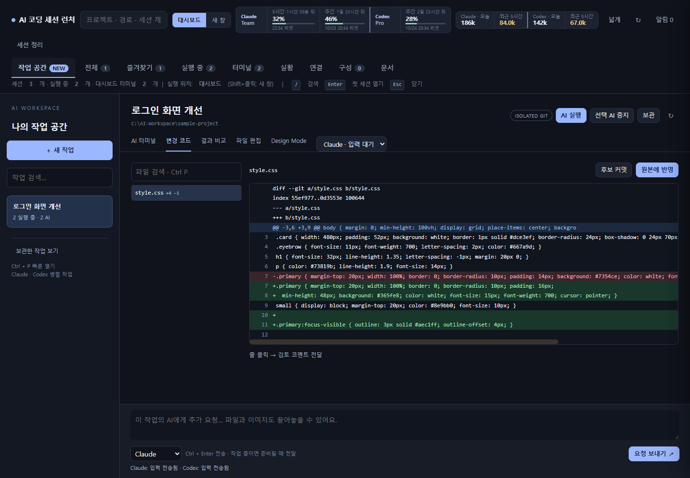

**변경 코드** → 검토할 AI 선택 → 왼쪽 파일 선택. 빨간색은 삭제, 초록색은 추가한 코드입니다. 변경 줄을 클릭하면 그 파일·줄에 대한 코멘트를 AI에게 전달할 수 있습니다.

반영 순서는 **후보 검토 → 선택 AI 중지 → 후보 커밋 → 원본에 반영 → 확인**입니다. 후보 커밋은 선택 후보의 변경 파일 전체를 커밋합니다.

원본 브랜치·시작 커밋·파일 상태가 달라졌거나 후보가 실행 중/미커밋 상태라면 반영을 중단합니다. 원본 반영은 **fast-forward만** 지원하며 강제 병합·자동 푸시는 하지 않습니다. 일반 폴더 작업에는 이 Git 반영 기능이 없습니다.

## 8. Claude·Codex 결과 나란히 비교

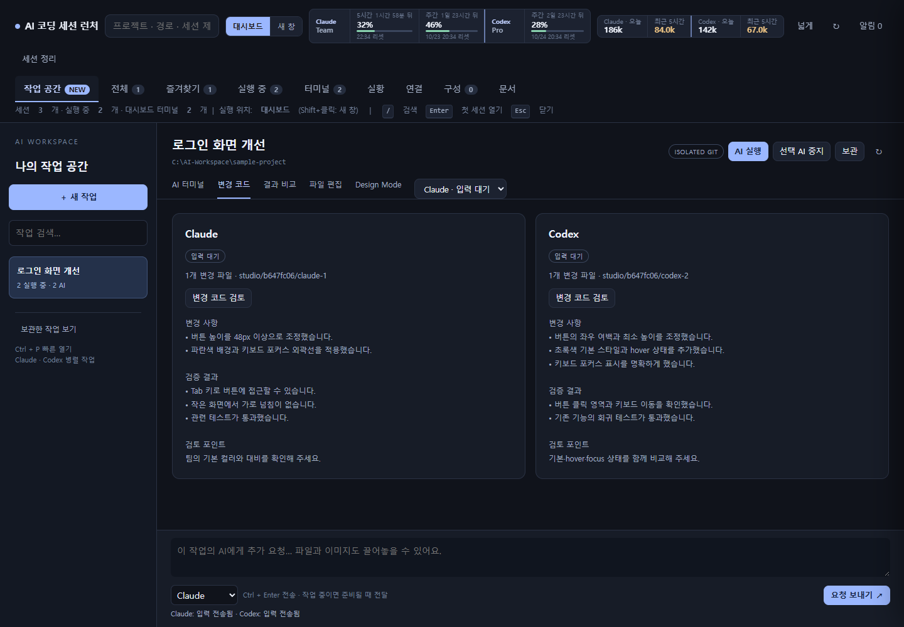

**결과 비교**에서 각 AI의 최근 응답과 변경 파일 수를 함께 봅니다. **변경 코드 검토**로 해당 AI의 diff에 바로 이동할 수 있습니다.

응답 요약뿐 아니라 실제 변경 코드와 검증 결과를 함께 확인해 후보를 고르세요. CLI가 아직 대화 기록을 저장하지 않았다면 응답이 비어 있을 수 있으므로 터미널에서 진행 상태를 확인합니다.

## 9. 파일 검색·직접 편집

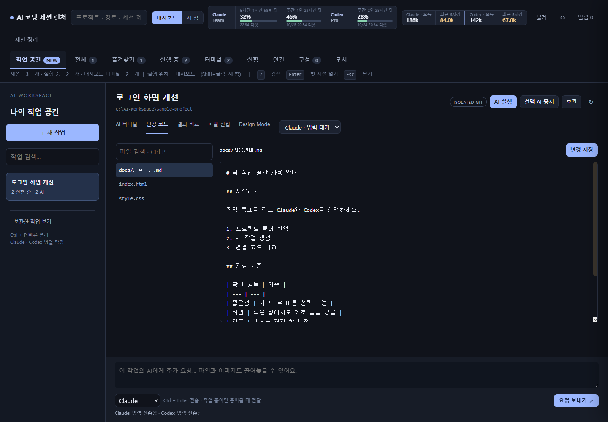

**파일 편집** → 파일 검색·선택 → 수정 → **변경 저장** 또는 **Ctrl+S**.

현재 AI 작업 공간의 UTF-8 텍스트 파일을 편집합니다(최대 512KB). AI나 다른 창이 먼저 파일을 바꾸면 충돌을 알려 덮어쓰기를 막습니다. 이 경우 파일을 다시 열어 내용을 비교하세요.

## 10. Ctrl+P로 작업·파일 빠르게 열기

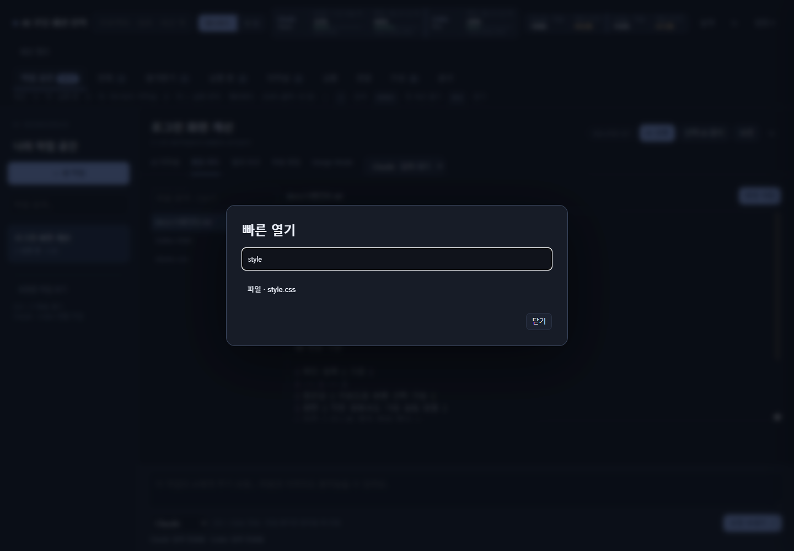

작업 공간에서 **Ctrl+P** → 작업 이름 또는 파일 경로 입력 → 결과 선택. **Esc**로 닫습니다. 파일 검색은 현재 선택한 AI 작업 공간 기준입니다.

## 11. Design Mode — 화면 요소로 수정 요청

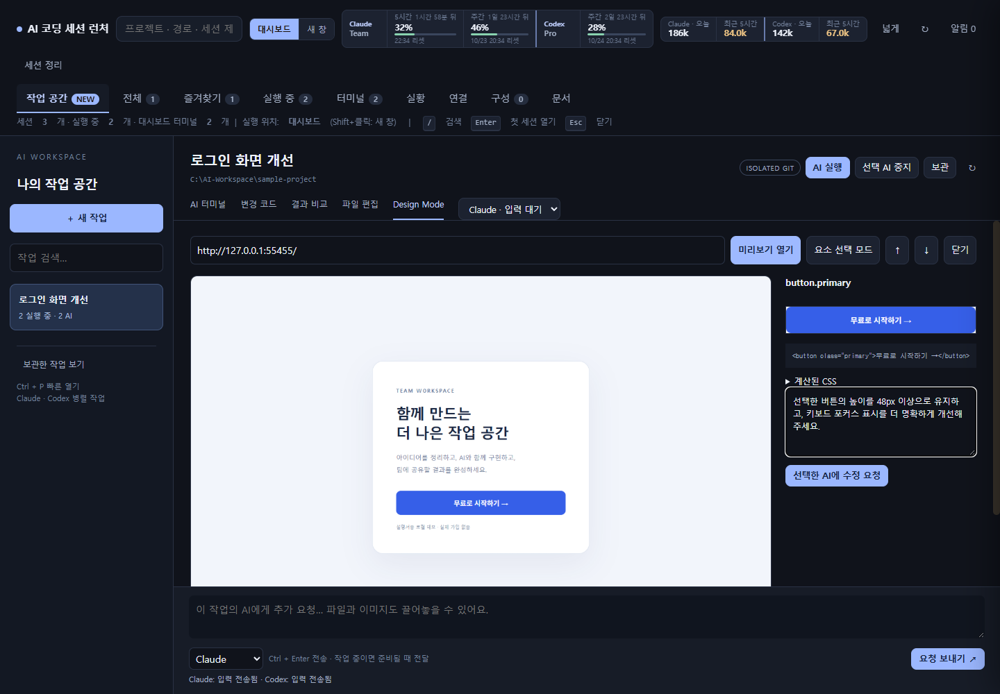

**Design Mode → 로컬 개발 서버 주소 입력 → 미리보기 열기 → 요소 선택 → 수정 요청 입력 → 선택한 AI에 수정 요청**.

선택한 요소의 **HTML·계산된 CSS·캡처 파일 경로**를 요청과 함께 전달합니다. **클릭 모드**로 버튼·링크를 조작하고, ↑/↓로 화면을 스크롤할 수 있습니다.

설치된 Chrome/Edge로 1280×800 화면을 렌더링하며 **localhost/127.0.0.1 개발 서버**를 지원합니다. 화면은 실시간 영상이 아닌 스냅샷입니다. 코드 수정 결과를 보려면 **미리보기 열기**를 다시 누르세요. 원격 사이트 로그인·폼 입력 자동화는 지원하지 않습니다.

## 12. 문서 탭에서 Markdown 읽고 수정하기

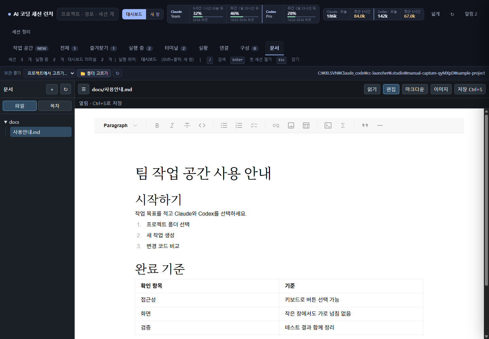

**문서 → 프로젝트/폴더 선택 → .md 파일 선택**. 터미널에 출력된 Markdown 문서 경로를 클릭해 바로 열 수도 있습니다.

**읽기 / 편집 / 마크다운**으로 보기 방식을 바꾸고, 목차로 제목에 이동합니다. 이미지 버튼·붙여넣기·드롭으로 이미지를 넣고 **Ctrl+S**로 저장합니다. 새 문서는 목록 위 **＋**로 만듭니다.

다른 프로그램이 파일을 수정했다면 저장 충돌을 알립니다. 임시저장 복구 안내가 뜬 경우 복구 내용을 확인한 뒤 저장하세요.

## 13. 실행 중 세션이 많이 쌓였을 때 정리하기

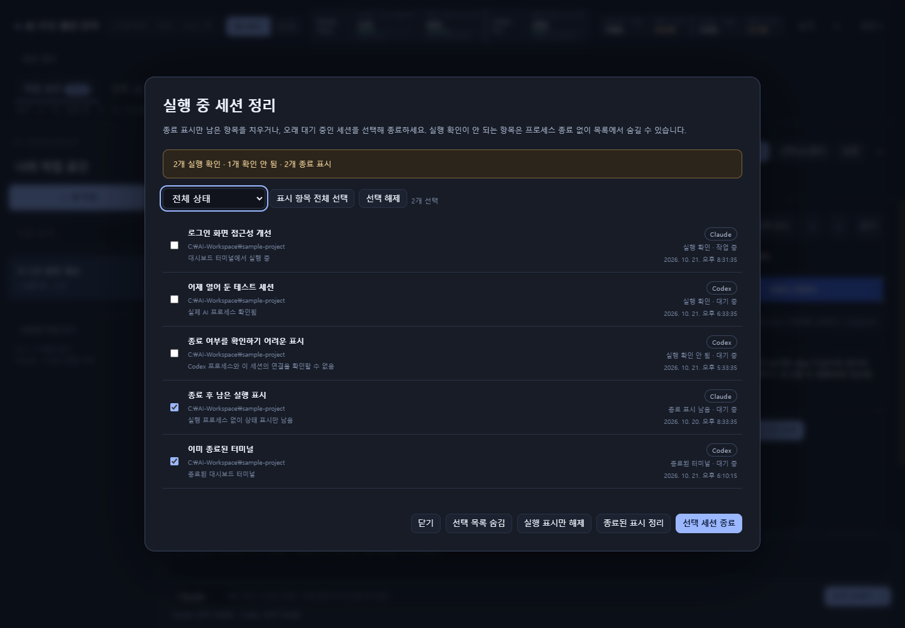

헤더 **세션 정리** → 상태 필터 → 대상 선택 → 목적에 맞는 버튼 선택.

| 버튼 | 무엇을 바꾸나 |
| --- | --- |
| 종료된 표시 정리 | 종료가 확인된 상태 표시와 죽은 터미널 정리 |
| 실행 표시만 해제 | 실행 여부를 확정하기 어려운 항목의 상태 표시만 해제. 프로세스는 종료하지 않음 |
| 선택 세션 종료 | 실제 실행을 확인한 AI 세션 종료. 확인 창에서 대상·작업 중인 수 확인 |
| 선택 목록 숨김 | 세션 목록의 숨김 표시 설정. 프로세스나 대화 기록은 유지 |

**1시간 이상 대기 중** 필터로 오래 열어 둔 세션을 찾습니다. Codex는 상태 기록만으로 실제 실행을 확인하기 어려운 경우가 있어 **실행 확인 안 됨**으로 따로 표시합니다. 이런 항목은 일괄 종료하지 않습니다.

**실행 표시만 해제**한 세션도 실제 AI는 계속 실행 중일 수 있으며, 다음 활동이 감지되면 다시 나타납니다. **목록 숨김**만으로는 실행 중인 세션이 사라지지 않을 수 있습니다.

정리한 상태 파일은 `.studio/cleanup-backups`에 원본 경로와 함께 백업합니다. **대화 기록과 작업 파일은 삭제하지 않습니다.** 상태·프로세스가 바뀐 항목은 처리 결과에 건너뛴 사유를 보여 줍니다.

## 14. 응답 완료·승인 요청 알림

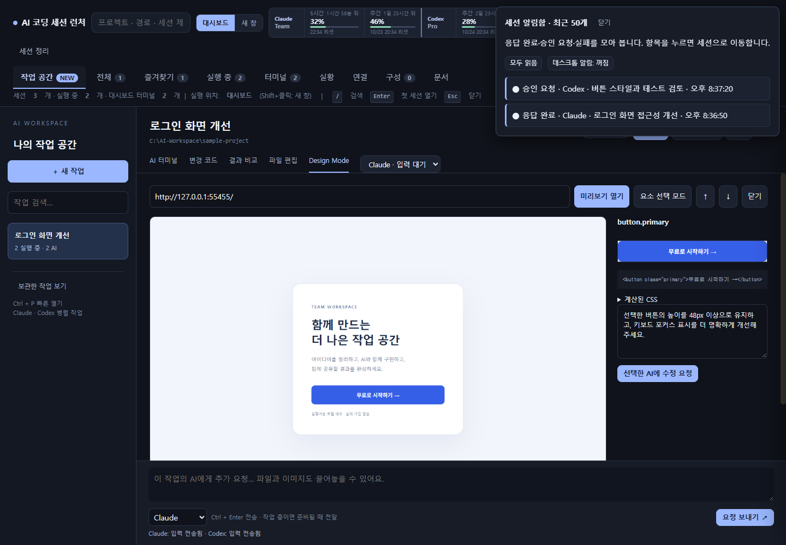

헤더 **알림**에서 최근 50개 완료·승인 요청·실패를 확인합니다. 항목을 누르면 해당 세션으로 이동하고, **모두 읽음**으로 미확인 표시를 정리합니다.

브라우저 알림 권한을 허용하면 데스크톱 알림도 사용할 수 있습니다. 실시간 관측 훅이 연결되어 있어야 새 이벤트가 들어옵니다.

## 15. 실황·연결에서 AI 활동 확인

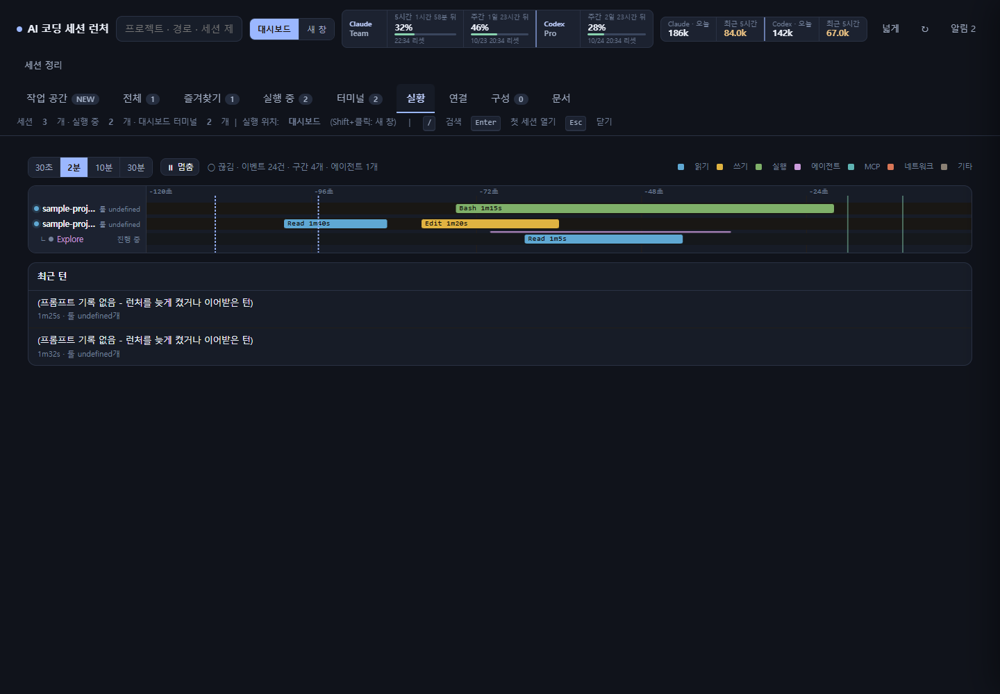

**실황**은 세션과 서브에이전트가 읽기·수정·명령 실행을 언제 했는지 보여 줍니다. 30초/2분/10분/30분으로 범위를 바꾸거나 멈춤으로 살펴봅니다.

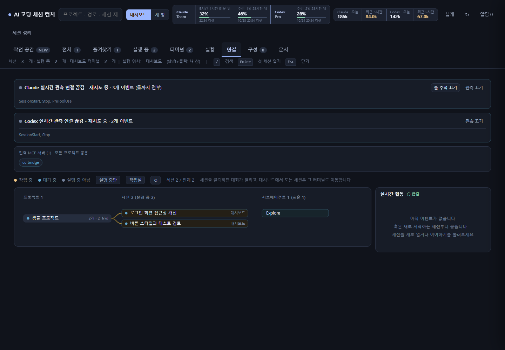

**연결**은 프로젝트 → 세션 → 서브에이전트 관계를 보여 줍니다. 세션을 클릭해 대화나 내장 터미널로 이동합니다. 실행 중만 보기로 범위를 줄일 수 있습니다.

`연결 끊김` 또는 이벤트 없음이 보이면 대시보드 서버와 훅 연결을 확인하세요. 훅 설정은 새로 시작하는 세션부터 적용됩니다. 위 화면의 활동 구간·연결 관계는 설명용 예시입니다.

## 16. 구성에서 설정·MCP 확인

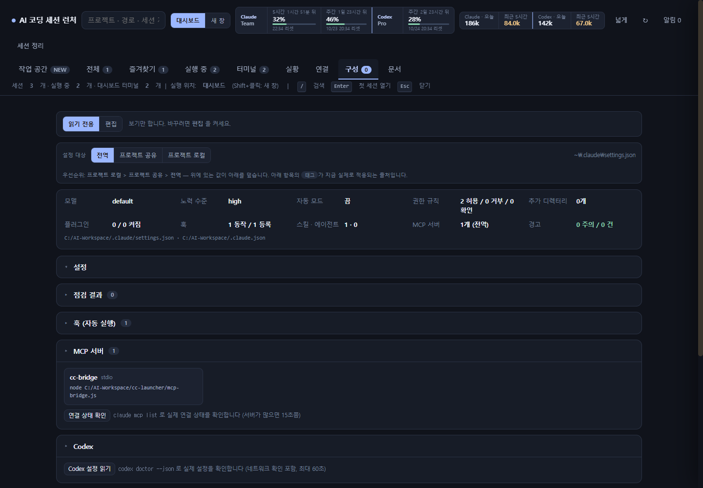

**구성**에서 모델, 권한 규칙, 훅, MCP 서버, 플러그인, 스킬·에이전트와 프로젝트 설정 파일을 봅니다. 기본은 읽기 전용이며 바꾸려면 편집 모드와 설정 대상을 먼저 확인합니다.

**Codex 설정 읽기**는 별도 확인 버튼으로 실행합니다. 실제 표시 항목과 사용 가능한 설정은 설치된 CLI 버전에 따라 달라집니다. 회사에서 관리하는 정책은 대시보드의 설정 변경으로 해제되지 않습니다.

## 자주 헷갈리는 점

| 상황 | 확인할 것 |
| --- | --- |
| 새 기능이 안 보이거나 API 오류가 남 | 최신 코드와 서버 API 10 이상인지 확인 후 서버 재시작. 내장 AI는 중단될 수 있음 |
| 브라우저 새로고침과 서버 재시작이 같은가? | 다름. 브라우저 새로고침은 화면 재연결, 서버 재시작은 내장 AI 중단 |
| 작업 공간을 만들었는데 AI가 시작하지 않음 | 생성 후 **AI 실행** 필요. 터미널 안 시작 확인·로그인 상태도 확인 |
| 다른 AI에게 전달했는데 답이 안 돌아옴 | 자동 회신 기능이 아님. 대상 세션에서 답변 확인 |
| 원본 반영이 막힘 | 후보 중지·후보 커밋 여부와 원본 브랜치/파일 변경 여부 확인 |
| Design Mode에 화면이 안 뜸 | 로컬 개발 서버 실행 여부와 주소·포트, Chrome/Edge 설치 여부 확인 |
| 실행 중 수가 실제보다 많아 보임 | **세션 정리**에서 실행 확인·확인 안 됨·종료 표시를 구분 |

### 자주 쓰는 키

| 키 | 동작 |
| --- | --- |
| / | 기본 화면 검색창 포커스 |
| Ctrl+P | 작업 공간의 작업·파일 빠른 열기 |
| Ctrl+Enter | 작업 공간 추가 요청 전송 |
| Ctrl+S | 파일 편집·문서 저장 |
| Shift+Enter | 터미널 입력 중 줄바꿈 |
| Ctrl+C | 터미널에서 선택 내용 복사, 선택이 없으면 실행 중단 |
| Esc | 열려 있는 창·패널 닫기 |
